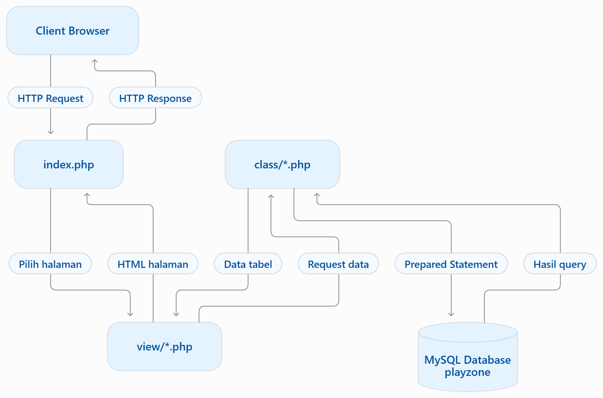

# TP7 DPBO 2025/2026

## Data Diri

| Keterangan  | Data                                      |
| ----------- | ----------------------------------------- |
| Nama        | Fakhri Fauzan                             |
| NIM         | 2501536                                   |
| Kelas       | C2                                        |
| Mata Kuliah | Desain dan Pemrograman Berorientasi Objek |

## Janji

Saya Fakhri Fauzan dengan NIM 2501536 mengerjakan Tugas Praktikum 7 dalam mata kuliah Desain dan Pemrograman Berorientasi Objek. Untuk keberkahan-Nya, saya tidak melakukan kecurangan seperti yang telah dispesifikasikan. Aamiin.

# Desain dan Fungsi Program

Program ini merupakan website **PlayZone — Game & Console Rental** yang dikembangkan menggunakan PHP Native dengan penerapan Pemrograman Berorientasi Objek (_Object-Oriented Programming_). Website ini digunakan untuk mengelola data game, pelanggan, dan penyewaan game.

Program menyediakan fitur CRUD (_Create, Read, Update, Delete_) pada setiap entitas, yaitu Games, Customers, dan Rentals. Pengguna dapat menambahkan data baru, melihat daftar data, mengubah data yang tersedia, serta menghapus data yang tidak diperlukan.

Program dikembangkan menggunakan PHP Native, HTML, CSS, dan MySQL sebagai sistem manajemen basis data. Koneksi database dilakukan menggunakan PDO (_PHP Data Objects_) dengan penerapan Prepared Statement untuk menjalankan query SQL.

Program terdiri dari beberapa kelas, yaitu `Database`, `Game`, `Customer`, dan `Rental`, yang memiliki tanggung jawab berbeda.

## Gambaran Flow Program

Berikut merupakan gambaran singkat alur komunikasi antara browser, file PHP, dan database dalam aplikasi PlayZone.



Diagram tersebut menunjukkan bagaimana `index.php` menerima HTTP Request dari browser, menentukan halaman yang akan ditampilkan, serta menghubungkan file view dengan class PHP untuk mengambil dan mengelola data dari database MySQL. Hasil query kemudian dikembalikan ke view untuk ditampilkan sebagai halaman HTML kepada pengguna.

Diagram ini merupakan gambaran ringkas alur program, sedangkan penjelasan lebih lengkap mengenai proses dan fungsi setiap kelas dijelaskan pada bagian berikutnya.

## Penjelasan Kelas

### 1. Kelas `Database`

Kelas `Database` bertanggung jawab untuk mengatur koneksi antara aplikasi PHP dan database MySQL.

Beberapa fungsi utama kelas ini:

- **Konfigurasi Database:** Menyediakan informasi host, nama database, username, dan password.
- **`getConnection()`**: Membuat koneksi database menggunakan PDO dan mengembalikan objek koneksi yang dapat digunakan oleh kelas lainnya.
- **Error Handling:** Menangani kegagalan koneksi database melalui exception PDO.

Kelas ini menjadi bagian utama yang digunakan oleh kelas `Game`, `Customer`, dan `Rental` untuk menjalankan operasi database.

### 2. Kelas `Game`

Kelas `Game` digunakan untuk merepresentasikan data game yang tersedia untuk disewakan.

Kelas ini memiliki atribut berikut:

| Atribut      | Tipe Data | Keterangan               |
| ------------ | --------- | ------------------------ |
| `id`         | `int`     | ID game                  |
| `nama`       | `string`  | Nama game                |
| `platform`   | `string`  | Platform game            |
| `genre`      | `string`  | Genre game               |
| `harga_sewa` | `int`     | Harga sewa game per hari |

Beberapa method utama yang disediakan:

- **`getAll()`**: Mengambil seluruh data game dari database.
- **`create()`**: Menambahkan data game baru.
- **`update()`**: Mengubah data game berdasarkan ID.
- **`delete()`**: Menghapus data game berdasarkan ID.

Seluruh operasi database menggunakan Prepared Statement untuk menjalankan query SQL.

### 3. Kelas `Customer`

Kelas `Customer` digunakan untuk merepresentasikan data pelanggan yang menggunakan layanan penyewaan game.

Kelas ini memiliki atribut berikut:

| Atribut | Tipe Data | Keterangan              |
| ------- | --------- | ----------------------- |
| `id`    | `int`     | ID pelanggan            |
| `nama`  | `string`  | Nama pelanggan          |
| `no_hp` | `string`  | Nomor telepon pelanggan |

Beberapa method utama yang disediakan:

- **`getAll()`**: Mengambil seluruh data pelanggan dari database.
- **`create()`**: Menambahkan data pelanggan baru.
- **`update()`**: Mengubah data pelanggan berdasarkan ID.
- **`delete()`**: Menghapus data pelanggan berdasarkan ID.

Nomor telepon pelanggan divalidasi agar hanya berisi angka. Selain itu, penghapusan pelanggan yang masih memiliki data Rental akan ditangani agar tidak menyebabkan pelanggaran relasi database.

### 4. Kelas `Rental`

Kelas `Rental` digunakan untuk merepresentasikan transaksi penyewaan game oleh pelanggan.

Kelas ini memiliki atribut berikut:

| Atribut        | Tipe Data | Keterangan                                   |
| -------------- | --------- | -------------------------------------------- |
| `id`           | `int`     | ID penyewaan                                 |
| `customer_id`  | `int`     | ID pelanggan yang melakukan penyewaan        |
| `game_id`      | `int`     | ID game yang disewa                          |
| `tanggal_sewa` | `string`  | Tanggal penyewaan                            |
| `durasi`       | `int`     | Lama penyewaan dalam hari                    |
| `biaya`        | `int`     | Total biaya penyewaan yang dihitung otomatis |

Beberapa method utama yang disediakan:

- **`getAll()`**: Mengambil seluruh data Rental dengan menggabungkan tabel Rentals, Customers, dan Games menggunakan JOIN.
- **`create()`**: Menambahkan transaksi penyewaan baru beserta biaya yang dihitung otomatis.
- **`update()`**: Mengubah data penyewaan berdasarkan ID dan menghitung ulang biaya berdasarkan game serta durasi yang dipilih.
- **`delete()`**: Menghapus data penyewaan berdasarkan ID.
- **`hitungBiaya()`**: Mengambil harga sewa game dari database dan menghitung total biaya berdasarkan durasi penyewaan.

Biaya Rental tidak diinput secara manual oleh pengguna. Program menghitung biaya secara otomatis menggunakan rumus:

**Total Biaya = Harga Sewa Game per Hari × Durasi Penyewaan**

Sebagai contoh, apabila game memiliki harga sewa Rp25.000 per hari dan disewa selama 3 hari, maka total biaya penyewaan adalah Rp75.000.

Method `getAll()` menggunakan JOIN untuk menampilkan nama pelanggan dan nama game, sehingga informasi penyewaan dapat ditampilkan secara lebih informatif tanpa hanya menampilkan ID relasi.

Data Rental juga ditampilkan berdasarkan urutan ID secara ascending.

## Database

Program menggunakan database MySQL bernama `playzone` yang terdiri dari tiga tabel utama.

| Tabel       | Atribut                                                           | Keterangan                                   |
| ----------- | ----------------------------------------------------------------- | -------------------------------------------- |
| `games`     | `id`, `nama`, `platform`, `genre`, `harga_sewa`                   | Menyimpan data game dan harga sewa per hari  |
| `customers` | `id`, `nama`, `no_hp`                                             | Menyimpan data pelanggan                     |
| `rentals`   | `id`, `customer_id`, `game_id`, `tanggal_sewa`, `durasi`, `biaya` | Menyimpan data penyewaan beserta total biaya |

### Relasi Antar Tabel

- **Customers – Rentals:** Satu pelanggan dapat memiliki beberapa transaksi penyewaan.
- **Games – Rentals:** Satu game dapat muncul dalam beberapa transaksi penyewaan.
- Tabel `rentals` memiliki Foreign Key `customer_id` yang mengacu pada `customers.id` dan `game_id` yang mengacu pada `games.id`.

Relasi tersebut menjaga konsistensi data antara pelanggan, game, dan transaksi penyewaan.

# Alur Program

1. Pengguna menjalankan website PlayZone melalui browser.
2. Halaman utama menampilkan menu navigasi Games, Customers, dan Rentals.
3. Pengguna memilih halaman yang ingin dikelola melalui navigasi website.
4. Program mengambil data dari database menggunakan kelas terkait dan menampilkan data dalam bentuk tabel.
5. Pengguna dapat menambahkan data melalui formulir yang tersedia.
6. Ketika pengguna memilih Edit, program mengambil data berdasarkan ID dan menampilkan data tersebut pada formulir untuk diperbarui.
7. Ketika pengguna memilih Hapus, program memeriksa apakah data masih digunakan oleh transaksi Rental sebelum melakukan penghapusan.
8. Pada halaman Rentals, program mengambil data pelanggan dan game untuk ditampilkan pada pilihan formulir penyewaan.
9. Pengguna mengisi Customer, Game, Tanggal Sewa, dan Durasi penyewaan. Biaya tidak diinput secara manual.
10. Ketika Rental dibuat atau diperbarui, program mengambil harga sewa game dari database dan menghitung total biaya berdasarkan durasi penyewaan.
11. Data Rental ditampilkan dengan nama pelanggan dan nama game melalui query JOIN.
12. Seluruh operasi perubahan data dilakukan melalui request POST dan dilanjutkan dengan redirect ke halaman terkait.
13. Program menggunakan Prepared Statement untuk menjalankan query database serta melakukan escaping output menggunakan `htmlspecialchars()` untuk membantu mencegah penyisipan HTML yang tidak diinginkan.

# Cara Menjalankan Program

1. Pastikan XAMPP telah tersedia dan Apache serta MySQL berjalan.
2. Clone atau download repository `TP7DPBO2526C2` dari GitHub.
3. Letakkan folder proyek di dalam direktori `htdocs` XAMPP.
4. Buka phpMyAdmin melalui browser.
5. Buat database dengan nama `playzone`.
6. Import file `database/playzone.sql` ke database `playzone`.
7. Pastikan konfigurasi koneksi database pada `config/database.php` sesuai dengan lingkungan lokal.
8. Buka browser dan akses website melalui alamat:

   `http://localhost/TP7DPBO2526C2/`

9. Website PlayZone dapat digunakan untuk mengelola data Games, Customers, dan Rentals.

# Dokumentasi Program

Dokumentasi berikut menunjukkan tampilan website dan fitur-fitur utama PlayZone.

## Screenshot

| Dokumentasi                | File                                      |
| -------------------------- | ----------------------------------------- |
| Tampilan halaman Games     | `Dokumentasi/Screenshot/01_Games.png`     |
| Tampilan halaman Customers | `Dokumentasi/Screenshot/02_Customers.png` |
| Tampilan halaman Rentals   | `Dokumentasi/Screenshot/03_Rentals.png`   |

## Video

Demonstrasi keseluruhan program mencakup CRUD Games, Customers, dan Rentals, pengujian relasi, perhitungan biaya otomatis, serta validasi.

[Tonton video demonstrasi PlayZone di YouTube](https://youtu.be/Nc4tNaydVZY)

# Struktur Repository

```text
TP7DPBO2526C2/
├── class/
│   ├── Game.php
│   ├── Customer.php
│   └── Rental.php
├── config/
│   └── database.php
├── database/
│   └── playzone.sql
├── view/
│   ├── games.php
│   ├── customers.php
│   └── rentals.php
├── Dokumentasi/
│   ├── Flow_Program_PlayZone.png
│   └── Screenshot/
│       ├── 01_Games.png
│       ├── 02_Customers.png
│       └── 03_Rentals.png
├── index.php
├── style.css
└── README.md
```

# Kesimpulan

Program PlayZone merupakan website pengelolaan penyewaan game yang dikembangkan menggunakan PHP Native dengan menerapkan konsep Pemrograman Berorientasi Objek.

Program menerapkan enkapsulasi melalui penggunaan atribut private dan method pada kelas `Database`, `Game`, `Customer`, serta `Rental`. Pemisahan kelas dan file view membantu membagi tanggung jawab pengelolaan data, koneksi database, dan tampilan antarmuka.

Program juga menerapkan operasi CRUD pada tiga entitas, penggunaan PDO dan Prepared Statement untuk mengakses database, serta relasi Foreign Key dan JOIN untuk menghubungkan data pelanggan, game, dan transaksi penyewaan.

Pada transaksi Rental, biaya penyewaan dihitung secara otomatis berdasarkan harga sewa game per hari dan durasi penyewaan. Dengan demikian, pengguna tidak perlu menginput total biaya secara manual.

Melalui website PlayZone, pengguna dapat mengelola data game, pelanggan, dan penyewaan secara terstruktur dengan antarmuka berbasis GUI.
